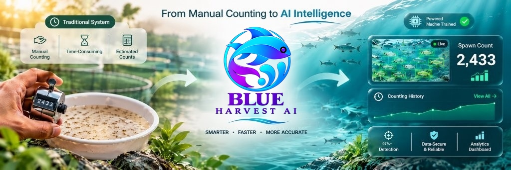
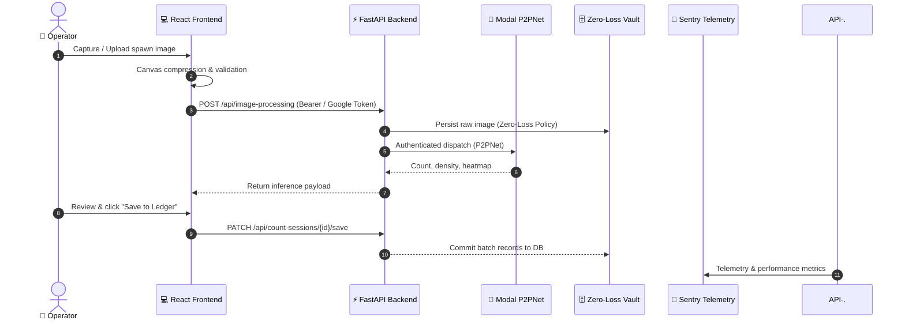
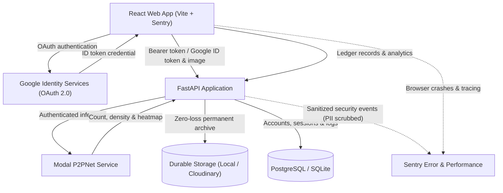

<div align="center">



# 🐟 BlueHarvest AI

### Modern Aquaculture Vision & Intelligent Hatchery Ledger

*Capture a sample, estimate fry & spawn population with deep learning, and secure permanent hatchery records.*

<p align="center">
  <a href="https://react.dev/"></a>
  <a href="https://fastapi.tiangolo.com/"></a>
  <a href="https://www.sqlalchemy.org/"></a>
  <a href="#model-integration"></a>
  <a href="https://sentry.io/"></a>
  <a href="#development-checks"></a>
  <a href="#current-scope"></a>
</p>

<p align="center">
  <a href="#quick-start"><b>🚀 Quick Start</b></a> &nbsp;•&nbsp;
  <a href="#interactive-features"><b>✨ Features</b></a> &nbsp;•&nbsp;
  <a href="#architecture"><b>🏛️ Architecture</b></a> &nbsp;•&nbsp;
  <a href="#model-integration"><b>🧠 AI Vision</b></a> &nbsp;•&nbsp;
  <a href="#api-reference"><b>📡 API Docs</b></a> &nbsp;•&nbsp;
  <a href="#deployment"><b>🚢 Deployment</b></a>
</p>

</div>

---

### ⚡ System Status & Production Health

| Component | Status | Metric / Engine | Description |
| :--- | :---: | :--- | :--- |
| **Frontend UI** | 🟢 `Active` | React 19 + Vite 6 + Lucide | 60 unit tests passing, zero-lint warnings, dark/light/system theme |
| **Backend API** | 🟢 `Active` | FastAPI + SQLAlchemy 2.0 | 253 backend tests passing, Argon2id & Google OAuth 2.0 auth |
| **AI Vision Cluster** | ⚡ `Serverless` | Modal P2PNet Engine | High-density spawn/fry point detection & spatial heatmaps |
| **Data Retention** | 🔒 `Zero-Loss` | `RETAIN_ALL_UPLOADS=true` | Permanent raw audit vault (Cloudinary / Local); zero preview pruning |
| **Auth & Security** | 🛡️ `Protected` | Double-Submit CSRF + JWT | Opaque rotating refresh tokens, rate limiting, and inference locks |
| **Observability** | 📡 `Ingesting` | Sentry Real-time Monitoring | End-to-end trace sampling with client/server PII scrubbing |

---

## Overview

BlueHarvest AI is an image-based fish spawn and fry counting application tailored for aquaculture hatchery workflows. Its modern React interface combines image upload, live camera capture, instant deep-learning count results, a hatchery ledger, and farm analytics into one unified dashboard. A production-hardened FastAPI backend manages operator accounts, persistent ledger records, and secure authenticated requests to an external Modal-hosted P2PNet inference cluster.

White surfaces, water-blue accents, fish illustrations, and farm landscapes connect the digital experience to the hatchery environment it serves.


<p align="center"><sub>Landscape artwork used by the application. This is an illustration, not a screenshot or a model result.</sub></p>

> **Current status:** this repository contains a working application prototype and an inference adapter. Live counting requires a configured Modal service. Model training code, weights, and a reproducible accuracy or latency benchmark are not included here.

<a id="interactive-features"></a>
## ✨ Interactive Features & Workflows

<details open>
<summary><b>📸 Aquaculture Vision & Instant Inference</b></summary>
<br>

| Feature | Description |
| :--- | :--- |
| **Multi-Format Ingestion** | Upload JPEG, PNG, WebP, BMP, or TIFF images. Default limit: 12 MB with 60-million-pixel dimension guards. |
| **Live Camera Capture** | Direct in-browser viewfinder with front/rear camera toggling and one-click snapshot capture. |
| **Canvas Compression** | Client-side compression scales large mobile photos automatically before transmission without loss of fry edge details. |
| **Model Outputs** | Displays overall point count, latency benchmarks, density classifications, and spatial heatmap overlays (when returned by provider). |

</details>

<details open>
<summary><b>📒 Hatchery Ledger & Farm Intelligence</b></summary>
<br>

| Feature | Description |
| :--- | :--- |
| **Hatchery Ledger** | Permanent record keeping for counted batches with species classification, pond location, and mortality notes. |
| **Search & Filtering** | Instant client-side search across loaded sessions with location tags and date sorting. |
| **Temporal Insights** | Aggregated spawn metrics across `today`, `this_week`, `this_month`, `7_days`, `30_days`, and `all_time`. |
| **Data Exports** | 1-click sanitized CSV exports for spreadsheets and browser-native PDF print formatting. |

</details>

<details open>
<summary><b>🔒 Enterprise Security & Zero-Loss Data Vault</b></summary>
<br>

| Feature | Description |
| :--- | :--- |
| **Zero-Loss Storage** | Configurable `RETAIN_ALL_UPLOADS=true` preserves all uploaded imagery and audit proofs permanently, preventing accidental cleanup. |
| **Dual Authentication** | Argon2id-hashed passwords or 1-click Google OAuth 2.0 Web Client authentication. |
| **Opaque Token Sessions** | Short-lived JWT access tokens paired with rotating HttpOnly refresh cookies and double-submit CSRF protection. |
| **PII Scrubbed Observability**| Sentry error tracking and performance APM with automated client/server credential and PII scrubbing. |

</details>

Google OAuth 2.0, Sentry monitoring, Modal inference, and SMTP/Fast2SMS recovery require external provider configuration. For local testing, mock fallbacks and SQLite defaults are used.

## Counting workflow

1. **Sign in** with an operator account or Google OAuth.
2. **Upload or capture** a still image of the sample.
3. **Request inference.** FastAPI validates image integrity and persists raw captures to durable zero-loss storage, then sends it to Modal.
4. **Inspect the result.** Review the returned count and available model outputs (density classifications, heatmaps).
5. **Save to the Hatchery Ledger.** The frontend creates a record and marks it as saved. Saved records contribute to farm summaries.



*Note: Inference and ledger persistence are separate operations. Uploading an image does not automatically create a saved ledger record.*

## Architecture



The model runs outside this repository. The backend forwards HTTP requests; it does not load or train P2PNet locally. SQLite is the local default; PostgreSQL connection URLs are supported by the SQLAlchemy setup.

| Layer | Stack |
| :--- | :--- |
| Frontend | React 19, Vite, Lucide React, Modular Tabs (`DashboardTab`, `LedgerTab`, `InsightsTab`, `ProfileTab`), Sentry React |
| Backend | FastAPI, Pydantic v2, SQLAlchemy 2.0, Alembic, Sentry SDK |
| Authentication | Argon2id password hashes, Google OAuth 2.0, JWT access tokens, opaque refresh tokens with CSRF double-submit |
| Image handling | Pillow validation, zero-loss durable storage (`RETAIN_ALL_UPLOADS`), Cloudinary signed assets / local fallback |
| Observability & Security | Sentry application monitoring with strict PII scrubbing, rate limiting, and inference locks |
| External services | Google Identity Services, Cloudinary storage, Modal serverless inference, SMTP / Fast2SMS recovery |
| Quality tools | Pytest (253 tests), Node Test Runner (60 tests), and Oxlint |
| Deployment files | Docker Compose, Render Blueprint (`render.yaml`), Netlify (`netlify.toml`), and Vercel rewrite |

<a id="quick-start"></a>
## 🚀 Quick start

Run from the repository root using two terminals or Docker Compose.

### System prerequisites

| Environment Component | Requirement | Recommended Target |
| :--- | :--- | :--- |
| **Python Runtime** | Python 3.12+ | Python 3.12 (matches container target) |
| **Node.js Engine** | `^20.19.0` or `>=22.12.0` | Node.js LTS (matches Vite lockfile) |
| **Package Managers** | `pip` & `npm` | Deterministic builds via `npm ci` |
| **Browser Context** | HTTPS or `localhost` | Required for `MediaDevices.getUserMedia` camera capture |
| **Container Engine** | Docker & Compose *(Optional)* | Multi-container local orchestration |

---

### Interactive Setup Guides

<details open>
<summary><b>🪟 Setup Option 1: Windows (PowerShell)</b></summary>
<br>

#### Step 1: Prepare & launch the FastAPI backend (Terminal 1)
```powershell
cd blueharvest-backend
python -m venv .venv
.\.venv\Scripts\Activate.ps1
python -m pip install -r requirements.txt
if (-not (Test-Path .env)) { Copy-Item .env.example .env }
```

Generate a secure signing key and paste into `SECRET_KEY` in `blueharvest-backend/.env`:
```powershell
python -c "import secrets; print(secrets.token_urlsafe(48))"
```

Apply database migrations and start the development server:
```powershell
python -m alembic upgrade head
python -m uvicorn app.main:app --reload --host 127.0.0.1 --port 8000
```

#### Step 2: Prepare & launch the React frontend (Terminal 2)
```powershell
cd blueharvest-frontend
npm ci
if (-not (Test-Path .env)) { Copy-Item .env.example .env }
npm run dev
```

</details>

<details>
<summary><b>🐧 Setup Option 2: macOS / Linux (Bash / Zsh)</b></summary>
<br>

#### Step 1: Prepare & launch the FastAPI backend (Terminal 1)
```bash
cd blueharvest-backend
python3 -m venv .venv
source .venv/bin/activate
python -m pip install -r requirements.txt
test -f .env || cp .env.example .env
```

Generate a secure signing key:
```bash
python3 -c "import secrets; print(secrets.token_urlsafe(48))"
```

Apply database migrations and start the server:
```bash
python -m alembic upgrade head
python -m uvicorn app.main:app --reload --host 127.0.0.1 --port 8000
```

#### Step 2: Prepare & launch the React frontend (Terminal 2)
```bash
cd blueharvest-frontend
npm ci
test -f .env || cp .env.example .env
npm run dev
```

</details>

<details>
<summary><b>🐳 Setup Option 3: Docker Compose (All-in-One Backend)</b></summary>
<br>

The containerized backend builds Python 3.12, runs Alembic migrations automatically, and mounts an isolated `/data` volume for durable storage:
```bash
cd blueharvest-backend
docker compose up --build -d
```
Then start the frontend locally with `npm run dev` in `blueharvest-frontend`.

</details>

---

### 🌐 Local Service Access Dashboard

| Service | Address | Access Role | Description |
| :--- | :--- | :---: | :--- |
| **Web Application** | [http://localhost:5173](http://localhost:5173) | 🌐 Public | Main React 19 UI with Vite HMR |
| **API Root Information** | [http://localhost:8000](http://localhost:8000) | 🌐 Public | Backend service metadata & health |
| **Interactive OpenAPI Docs**| [http://localhost:8000/docs](http://localhost:8000/docs) | 🛠️ Swagger | Live testable API documentation |
| **ReDoc Specifications** | [http://localhost:8000/redoc](http://localhost:8000/redoc) | 📄 Specs | Clean API contract & schema views |
| **System Diagnostics** | [http://localhost:8000/api/diagnostics](http://localhost:8000/api/diagnostics) | 🩺 Health | Core DB reachability & provider readiness |

*Tip: Keep the same browser hostname throughout a local session; use `localhost` consistently rather than mixing it with `127.0.0.1`.*

### Optional local demo

Set `APP_ENV=development` and `DEMO_MODE_ENABLED=true`, then restart the backend after applying migrations. Startup seeds a demo account and four sample records when the fixture is absent.

| Field | Local demo value |
| :--- | :--- |
| Username | `samarth_aquafarm` |
| Email | `demo@blueharvest.local` |
| Password | `SpawnCounter2026!` |

Each demo login creates an isolated workspace with its own records, uploads, and session. Refreshing a session preserves that workspace; signing in again creates a new one. Fixture rows have API status `Demo sample`, and dashboards and exports visibly identify sample data. They are illustrative, not model predictions or evidence of accuracy. Use a personal account for lasting hatchery records and contact verification.

The supplied `.env.example` enables demo mode and development OTP exposure. Override those values for the clean configuration above. Demo mode does not enable inference.

## Model integration

Configure the real provider in `blueharvest-backend/.env`:

```dotenv
MODAL_ENABLED=true
MODAL_BASE_URL=https://your-service.modal.run
MODAL_KEY=your-private-modal-key
MODAL_SECRET=your-private-modal-secret
MODAL_HEALTH_PATH=/health
MODAL_PREDICT_PATH=/predict
MODAL_TIMEOUT_SECONDS=90
MODAL_REQUEST_FORMAT=multipart
MODAL_IMAGE_FIELD=image
MODAL_COUNT_FIELD=count
```

Replace the example URL and fields with the deployed service's contract. Its multipart field may be `file` rather than `image`; its count key may also differ. Restart the backend after changes. Keep credentials in the backend environment; frontend `VITE_*` values are exposed to the browser.

| Setting | Supported behavior |
| :--- | :--- |
| `MODAL_REQUEST_FORMAT` | `multipart`, `base64_json`, or `raw`. One request is sent without automatic format retries. |
| `MODAL_IMAGE_FIELD` | Multipart field name, or the JSON key for base64. |
| `MODAL_COUNT_FIELD` | Exact key or dotted path, such as `count` or `data.count`. When blank, the adapter searches supported count keys. |
| `MODAL_POINTS_FIELD` | Optional dotted path to a returned point list. Its length is used only when explicitly configured and no valid count was found. |

The adapter requires a non-negative integer count and returns it as `final_fish_count` and `final_count`. Optional confidence, time, length, density, and heatmap fields are forwarded only when present and accepted by the parser. Missing credentials return `503 model_not_configured`; a missing/invalid count returns `502 inference_count_missing`.

Authenticated `GET /api/model/health` checks remote reachability. `/api/diagnostics` reports configuration state and core database/directory readiness; it does not call the model or benchmark its latency.

### Configuration reference

These are application defaults unless stated otherwise. A private `.env` or hosting environment overrides them.

| Variable | Default / purpose |
| :--- | :--- |
| `APP_ENV` | `development`; use `production` for deployment. |
| `SECRET_KEY` | Replace the development fallback with a unique random secret. Production rejects short or recognized placeholder values. |
| `DATABASE_URL` | `sqlite:///./data/blueharvest.db`; PostgreSQL URLs are also supported. |
| `UPLOAD_DIR` | `./data/uploads`; relative paths resolve from the backend working directory. |
| `UPLOAD_STORAGE_PERSISTENT` | `false`; set `true` only for a production directory mounted on persistent storage. |
| `CLOUDINARY_URL` / `CLOUDINARY_*` | Private durable image storage; required on Render Free. See the storage upgrade guide. |
| `MAX_UPLOAD_MB` | `12`. |
| `CORS_ORIGINS` | `http://localhost:5173,http://127.0.0.1:5173`; add the exact deployed frontend origin. |
| `ACCESS_TOKEN_MINUTES` / `REFRESH_TOKEN_DAYS` | `15` minutes / `14` days. |
| `COOKIE_SECURE` / `COOKIE_SAMESITE` | `false` / `lax` locally. A cross-site HTTPS frontend requires `true` / `none`. |
| `MODAL_ENABLED` | `false`; the example environment enables it but leaves credentials blank. |
| `DEMO_MODE_ENABLED` / `DEV_EXPOSE_OTP` | Both default to `false`; the example environment enables them. OTP exposure is restricted to development/dev/test. |
| `OTP_TTL_MINUTES` / `OTP_MAX_ATTEMPTS` | `10` minutes / `5` attempts per challenge. |
| `GOOGLE_CLIENT_ID` | Backend Google OAuth client ID (validates token audience); pair with `VITE_GOOGLE_CLIENT_ID`. |
| `GOOGLE_CLIENT_SECRET` | *(Optional)* Google OAuth client secret; only required if using server-side auth code exchange. |
| `VITE_GOOGLE_CLIENT_ID` | Frontend Google OAuth client ID for Google Identity Services. |
| `SENTRY_DSN` / `VITE_SENTRY_DSN` | Backend and frontend Sentry DSNs for real-time error tracking and performance monitoring with strict PII scrubbing. |
| `RETAIN_ALL_UPLOADS` | `false` by default, set `true` in production to enforce zero data loss (disables preview purging and image file deletion). |
| `SMTP_HOST`, `SMTP_PORT`, `SMTP_FROM_EMAIL` | Email recovery; port defaults to `587`. Credentials and STARTTLS are configurable. |
| `FAST2SMS_API_KEY`, `FAST2SMS_ROUTE` | SMS OTP recovery for registered Indian mobile numbers via Fast2SMS. |
| `VITE_API_URL` | Frontend backend address. Set explicitly for deployment. |

See [blueharvest-backend/.env.example](blueharvest-backend/.env.example) and [blueharvest-frontend/.env.example](blueharvest-frontend/.env.example) for example settings. Google sign-in also requires the frontend origin to be authorized in the Google OAuth configuration.

<a id="api-reference"></a>
## 📡 Interactive API Reference

Authenticated endpoints require `Authorization: Bearer <access_token>`. Refresh and logout use the rotating HttpOnly refresh cookie. The browser client automatically retries authenticated requests after refreshing tokens.

<details open>
<summary><b>🔐 1. Authentication & Session Security Endpoints</b></summary>
<br>

| Method | Endpoint | Access | Purpose |
| :---: | :--- | :---: | :--- |
| `GET` | `/` | Public | Service information and root metadata. |
| `POST` | `/api/auth/signup` | Public | Register an account and issue a session. |
| `POST` | `/api/auth/login` | Public | Sign in with username/email and Argon2id password. |
| `POST` | `/api/auth/google` | Public | Authenticate with Google OAuth 2.0 ID token. |
| `GET` | `/api/auth/me` | Bearer | Fetch the currently authenticated user profile. |
| `POST` | `/api/auth/refresh` | Cookie | Rotate refresh session and issue new access token. |
| `POST` | `/api/auth/logout` | Cookie | Revoke matching refresh session and clear cookie. |
| `POST` | `/api/auth/password-reset/request` | Public | Request an email or SMS OTP recovery challenge. |
| `POST` | `/api/auth/password-reset/verify` | Public | Exchange valid recovery code for a reset token. |
| `POST` | `/api/auth/password-reset/confirm` | Public | Reset password using verified reset token. |

</details>

<details open>
<summary><b>🐟 2. Spawn Vision & Deep Learning Inference Endpoints</b></summary>
<br>

| Method | Endpoint | Access | Purpose |
| :---: | :--- | :---: | :--- |
| `POST` | `/api/image-processing` | Bearer | Submit multipart `image` for P2PNet spawn counting. |
| `POST` | `/api/preprocess-image` | Bearer | Validate multipart `file` readability and dimensions. |
| `GET` | `/api/model/health` | Bearer | Probe external Modal inference cluster connectivity. |
| `GET` | `/api/uploads/{filename}` | Authenticated | Retrieve authenticated durable upload asset. |

</details>

<details>
<summary><b>📒 3. Hatchery Ledger & Analytics Endpoints</b></summary>
<br>

| Method | Endpoint | Access | Purpose |
| :---: | :--- | :---: | :--- |
| `POST` | `/api/count-sessions` | Bearer | Persist verified inference result using session ID. |
| `GET` | `/api/count-sessions` | Bearer | Paginated history list with saved/demo filter flags. |
| `GET` | `/api/count-sessions/{session_id}` | Bearer | Retrieve batch details by internal ID or batch code. |
| `PATCH` | `/api/count-sessions/{session_id}/save` | Bearer | Toggle saved status for a verified batch. |
| `DELETE` | `/api/count-sessions/{session_id}` | Bearer | Soft-archive or remove a count session record. |
| `GET` | `/api/dashboard/summary` | Bearer | Aggregated farm metrics by date range and pond. |

</details>

<details>
<summary><b>⚙️ 4. Operator Settings & System Diagnostics Endpoints</b></summary>
<br>

| Method | Endpoint | Access | Purpose |
| :---: | :--- | :---: | :--- |
| `GET` | `/api/users/me` | Bearer | Read profile details and contact info. |
| `PATCH` | `/api/users/me` | Bearer | Update profile details and phone number. |
| `GET` | `/api/users/me/settings` | Bearer | Retrieve notification, theme, and language preferences. |
| `PATCH` | `/api/users/me/settings` | Bearer | Update application settings. |
| `GET` | `/api/notifications` | Bearer | List notifications for the authenticated user. |
| `PATCH` | `/api/notifications/{notification_id}/read` | Bearer | Mark notification as read. |
| `GET` | `/api/diagnostics` | Public | Ingest health, DB reachability, and provider status. |
| `GET` | `/api/demo/status` | Bearer | Report demo environment status for the active user. |

</details>

Dashboard ranges include `today`, `this_week`, `this_month`, `7_days`, `30_days`, and `all_time`. Listing accepts `limit` (default 100, maximum 500), `offset`, `include_unsaved`, and `include_demo`. The frontend fetches all pages of saved history.

CSV export runs in the frontend. There is no backend `/api/count-sessions/export` endpoint or JSON export workflow.

## Repository guide

| Location | Responsibility |
| :--- | :--- |
| [blueharvest-backend/app/main.py](blueharvest-backend/app/main.py) | Startup, CORS, Sentry telemetry, and route registration. |
| [blueharvest-backend/app/api/routes/](blueharvest-backend/app/api/routes/) | Auth, Google OAuth, counting, ledger, summaries, notifications, and diagnostics. |
| [blueharvest-backend/app/core/](blueharvest-backend/app/core/) | Settings, security helpers, and UTC timestamps. |
| [blueharvest-backend/app/models/](blueharvest-backend/app/models/) / [schemas/](blueharvest-backend/app/schemas/) | Database entities and request/response validation schemas. |
| [blueharvest-backend/app/services/](blueharvest-backend/app/services/) | Modal inference, zero-loss storage service, Google auth, and rate limiting. |
| [blueharvest-backend/alembic/](blueharvest-backend/alembic/) | Database migrations (indexes, storage providers, demo isolation). |
| [blueharvest-backend/tests/](blueharvest-backend/tests/) | 253 backend tests covering auth, inference, zero-loss storage, and demo isolation. |
| [blueharvest-frontend/src/App.jsx](blueharvest-frontend/src/App.jsx) | Browser routing, session restoration, and theme setup. |
| [blueharvest-frontend/src/components/](blueharvest-frontend/src/components/) | Auth views, `HomePage`, and shared UI components. |
| [blueharvest-frontend/src/components/tabs/](blueharvest-frontend/src/components/tabs/) | Modular tabs: `DashboardTab`, `LedgerTab`, `InsightsTab`, and `ProfileTab`. |
| [blueharvest-frontend/src/components/modals/](blueharvest-frontend/src/components/modals/) | Dialogs: `ScanResultModal` and `LiveCameraModal`. |
| [blueharvest-frontend/src/utils/](blueharvest-frontend/src/utils/) | Aquaculture batch pricing, mortality calculations, canvas compression, and CSV reports. |
| [blueharvest-frontend/src/api/client.js](blueharvest-frontend/src/api/client.js) | Fetch-based API client with automatic token refresh, CSRF protection, and bearer auth. |
| [blueharvest-frontend/tests/](blueharvest-frontend/tests/) | 60 frontend unit tests for client security, pricing, compression, and mortality. |

Local databases and uploads default to `blueharvest-backend/data/` and are excluded by the backend ignore rules. Frontend routes use the browser History API, so static hosting needs a fallback to `index.html`.

## Development checks

### Backend

Use a separate terminal so test-specific environment overrides do not carry into the development server:

```powershell
cd blueharvest-backend
.\.venv\Scripts\Activate.ps1
$env:APP_ENV = "test"
$env:DATABASE_URL = "sqlite://"
$env:MODAL_ENABLED = "false"
$env:DEMO_MODE_ENABLED = "false"
$env:UPLOAD_DIR = Join-Path $env:TEMP "blueharvest-test-uploads"
python -m pytest -q
```

The suite includes **253 passing tests** covering account flows, Google OAuth verification, password recovery, zero-loss storage durability, profile/settings persistence, ledger summaries, image validation behavior, and mocked Modal integration.

### Frontend

```bash
cd blueharvest-frontend
npm test        # Runs 60 automated unit tests (node --test)
npm run lint    # Oxlint static checks
npm run build   # Vite production build
```

To preview the production build locally:
```bash
npm run preview
```

The frontend suite includes **60 automated tests** verifying API client interceptors, CSRF cookie/header synchronization, token auto-refresh loops, private image authorization, client-side canvas compression, batch spawn valuation formulas, and multi-stage transportation mortality calculations.

## Deployment

### Docker Compose

The backend container uses Python 3.12, runs migrations before Uvicorn, and stores SQLite/uploads in a named `/data` volume.

```powershell
cd blueharvest-backend
docker compose up --build -d
```

Set a generated `SECRET_KEY` in `blueharvest-backend/.env`, configure the frontend origin, and disable demo mode first. Compose uses production mode and disables development OTP exposure. Run the frontend separately. Keep SQLite deployments to a single API instance.

### Render backend

[render.yaml](render.yaml) defines a Python web service and linked PostgreSQL database. Import it as a Render Blueprint, then configure private Modal credentials, exact model field mappings, and the frontend origin. Startup runs Alembic and binds Uvicorn to `$PORT`.

The Blueprint uses free plans and `/tmp/uploads`. Configure private Cloudinary storage before enabling uploads; production does not fall back to this ephemeral directory. See the [storage upgrade guide](docs/private-storage-and-pipeline-fixes.md). According to [Render documentation](https://render.com/docs/free), checked on **22 October 2026**:

- Free web-service files are ephemeral: uploads do not survive restarts or redeploys. PostgreSQL records do not make image files persistent.
- Free PostgreSQL databases expire after 30 days. This configuration suits temporary demos rather than durable hatchery records.
- Free web services block common SMTP ports, including 465 and 587. The current email-recovery adapter needs compatible hosting or a different delivery integration.

### Static frontend

| Host | Existing configuration | Required environment |
| :--- | :--- | :--- |
| Netlify | Root [netlify.toml](netlify.toml): base `blueharvest-frontend`, build `npm run build`, publish `dist` relative to the base; SPA fallback included. | `VITE_API_URL=https://your-backend.example` |
| Vercel | [blueharvest-frontend/vercel.json](blueharvest-frontend/vercel.json) supplies the SPA rewrite. Set project root to `blueharvest-frontend`. | `VITE_API_URL=https://your-backend.example` |

Allow the exact frontend origin in the backend. Cross-site HTTPS sessions need `COOKIE_SECURE=true` and `COOKIE_SAMESITE=none`; browser cookie policy can still affect refresh. Vite variables are build-time values, so rebuild after changing the API URL.

## Current scope

| Area | Current boundary |
| :--- | :--- |
| Counting | Still images only. Camera capture is manual; continuous live counting and video counting are not implemented. |
| Preprocessing | File readability and dimensions are checked. Enhancement, blur scoring, and positioning guidance are not implemented. |
| Model metrics | Accuracy and end-to-end latency are not established here. Length, density, and confidence depend on the upstream service. |
| Languages | A preference is stored; selecting it does not translate the interface. |
| Diagnostics | Database reachability, directory readiness, and provider settings are reported. Remote inference needs its authenticated health probe. |
| Production readiness | Backend regression tests and live Modal/Cloudinary/browser verification remain required. Configure durable image storage and review hosting limits before production use. |

Access tokens live in memory/sessionStorage. The opaque refresh token uses an HttpOnly cookie and is hashed in the database. Image reads require authentication and ownership for both local and Cloudinary storage. Model results are stored by the backend; saving accepts only the inference session ID. See [private storage and pipeline fixes](docs/private-storage-and-pipeline-fixes.md) for migration, deployment, and verification details.

<a id="troubleshooting"></a>
## 🛠️ Interactive Troubleshooting Guide

<details open>
<summary><b>🔍 Core System & Diagnostic Checks</b></summary>
<br>

| Symptom | Diagnostic Step & Resolution |
| :--- | :--- |
| **Missing database tables** | Run `python -m alembic upgrade head` from `blueharvest-backend` before starting Uvicorn. |
| **Refreshing `/history` returns 404** | Web server missing SPA fallback. Ensure Netlify/Vercel redirects all routes to `/index.html`. |
| **PowerShell script execution blocked**| Run `Set-ExecutionPolicy -Scope Process -ExecutionPolicy Bypass` in the active terminal session. |

</details>

<details open>
<summary><b>🧠 Inference & AI Vision Model</b></summary>
<br>

| Symptom | Diagnostic Step & Resolution |
| :--- | :--- |
| **`503 model_not_configured`** | Modal credentials missing in backend `.env`. Supply `MODAL_KEY` and `MODAL_SECRET` and set `MODAL_ENABLED=true`. |
| **`502 inference_count_missing`** | The remote Modal response keys do not match. Verify `MODAL_COUNT_FIELD` or `MODAL_POINTS_FIELD`. |
| **Inference gateway timeout** | Probe connectivity via `GET /api/model/health`. Verify network reachability or increase `MODAL_TIMEOUT_SECONDS`. |

</details>

<details>
<summary><b>🔒 Authentication, CORS & Camera</b></summary>
<br>

| Symptom | Diagnostic Step & Resolution |
| :--- | :--- |
| **Camera capture disabled** | Browser requires a secure origin (`https://` or `http://localhost`). Grant camera device permission in the browser prompt. |
| **CORS / Session cookie errors**| Confirm `CORS_ORIGINS` exactly matches frontend URL. For cross-site HTTPS, set `COOKIE_SECURE=true` and `COOKIE_SAMESITE=none`. |
| **Password reset OTP fails** | Verify SMTP or Fast2SMS credentials. In local dev mode, set `DEV_EXPOSE_OTP=true` to view codes in test responses. |
| **Uploads vanish on restart** | Cloud hosting (Render Free) filesystem is ephemeral. Configure `CLOUDINARY_URL` for durable cloud storage. |

</details>

## License

Proprietary and confidential. All rights reserved. No open-source license is granted by this repository.


<p align="center"><strong>BlueHarvest AI</strong><br /><sub>A clearer view of your hatchery, one image at a time.</sub></p>
