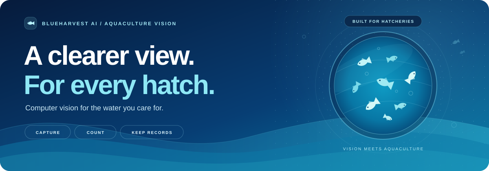
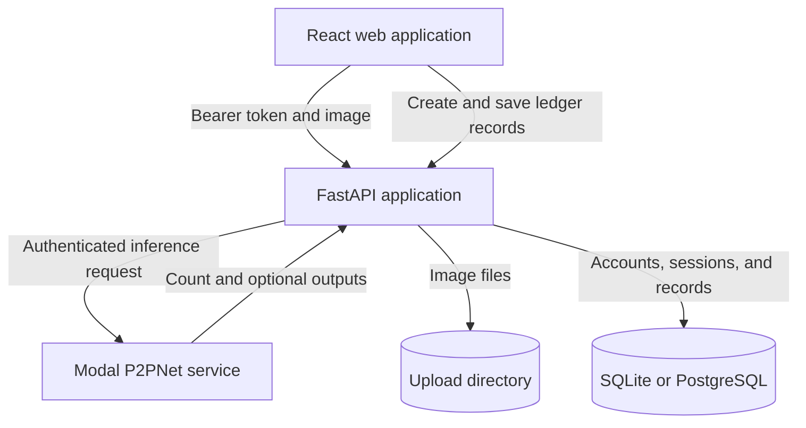

<div align="center">



# BlueHarvest AI

**Aquaculture vision. Organized hatchery records.**

Capture a photo, approximate the fish spawn count, and keep the result with your hatchery records.

[](https://react.dev/)
[](https://fastapi.tiangolo.com/)
[](https://www.sqlalchemy.org/)
[](#model-integration)
[](#current-scope)

[Explore](#overview) &nbsp; / &nbsp; [Run locally](#quick-start) &nbsp; / &nbsp; [Connect the model](#model-integration) &nbsp; / &nbsp; [API reference](#api-reference) &nbsp; / &nbsp; [Deploy](#deployment)

</div>

---

## Overview

BlueHarvest AI is an image-based fish spawn and fry counting application for aquaculture hatchery workflows. Its React interface brings image upload, camera capture, count results, a hatchery ledger, and farm summaries into one application. A FastAPI backend manages accounts, records, and requests to an external Modal-hosted P2PNet inference service.

White surfaces, water-blue accents, fish illustrations, and farm landscapes connect the experience to the environment it serves.


<p align="center"><sub>Landscape artwork used by the application. This is an illustration, not a screenshot or a model result.</sub></p>

> **Current status:** this repository contains a working application prototype and an inference adapter. Live counting requires a configured Modal service. Model training code, weights, and a reproducible accuracy or latency benchmark are not included here.

## What you can do

| Workflow | Implemented behavior |
| :--- | :--- |
| **Upload an image** | Submit JPEG, PNG, WebP, BMP, or TIFF images. The default upload limit is 12 MB, with a 60-million-pixel dimension cap. |
| **Capture with a camera** | Open a browser camera preview, switch front/rear cameras, and capture a still frame for image counting. |
| **View a result** | Display the model count and, when returned by the provider, processing time and a detection or heatmap image. |
| **Keep a hatchery ledger** | Save counts, search the loaded history, filter records, inspect batch details, and delete records. |
| **Review farm insights** | View saved count totals, session totals, and counts grouped by location across four date ranges. |
| **Export records** | Download an individual batch as CSV. Open a farm summary in the browser print dialog to print or save as PDF. |
| **Manage an account** | Register, sign in, edit profile details, recover a password, and save notification, language, and theme preferences. |
| **Choose an appearance** | Use Light, Dark (OLED), or System Appearance. Styling also respects reduced-motion preferences. |

Google sign-in, email recovery, SMS recovery, and inference require provider configuration. The notifications API supports existing user notifications; automatic notification generation is not implemented.

## Counting workflow

1. **Sign in** with an operator account.
2. **Upload or capture** a still image of the sample.
3. **Request inference.** FastAPI validates and stores the image, then sends it to Modal.
4. **Inspect the result.** Review the returned count and available model outputs.
5. **Save to the Hatchery Ledger.** The frontend creates a record and marks it as saved. Saved records contribute to farm summaries.

Inference and ledger persistence are separate operations. Uploading an image does not automatically create a saved ledger record.

## Architecture



The model runs outside this repository. The backend forwards HTTP requests; it does not load or train P2PNet locally. SQLite is the local default; PostgreSQL connection URLs are supported by the SQLAlchemy setup.

| Layer | Stack |
| :--- | :--- |
| Frontend | React, JavaScript, Vite, Lucide React, plain CSS |
| Backend | FastAPI, Pydantic, SQLAlchemy, Alembic |
| Authentication | Argon2 password hashes, JWT access tokens, opaque refresh tokens |
| Image handling | Pillow validation, local upload storage, HTTPX inference requests |
| Optional providers | Google Identity Services, SMTP email, Twilio SMS, Modal inference |
| Quality tools | Pytest and Oxlint |
| Deployment files | Docker Compose, Render, Netlify, and a Vercel frontend rewrite |

## Quick start

Run from the repository root using two terminals.

### Requirements

| Tool | Requirement |
| :--- | :--- |
| Python | Use Python 3.12 or newer for local setup. The Docker image uses Python 3.12. |
| Node.js | The committed Vite lockfile requires `^20.19.0` or `>=22.12.0`. Choose a currently supported release satisfying that requirement. See the [Vite guide](https://vite.dev/guide/). |
| npm | Use `npm ci` to install the committed frontend dependency versions. |
| Browser | Camera capture needs permission and a secure context, such as HTTPS or localhost. See [camera requirements](https://developer.mozilla.org/en-US/docs/Web/API/MediaDevices/getUserMedia). |
| Docker | Optional, for the container setup below. |

### 1. Prepare the backend

**Terminal 1 - Windows PowerShell**

```powershell
cd backend
python -m venv .venv
.\.venv\Scripts\Activate.ps1
python -m pip install -r requirements.txt
if (-not (Test-Path .env)) { Copy-Item .env.example .env }
```

The copy command preserves an existing `.env`. Generate a signing secret, then paste it into `SECRET_KEY` in `backend/.env`:

```powershell
python -c "import secrets; print(secrets.token_urlsafe(48))"
```

For a clean local account workflow without external providers, use:

```dotenv
APP_ENV=development
DATABASE_URL=sqlite:///./data/blueharvest.db
UPLOAD_DIR=./data/uploads
CORS_ORIGINS=http://localhost:5173,http://127.0.0.1:5173
MODAL_ENABLED=false
DEMO_MODE_ENABLED=false
DEV_EXPOSE_OTP=false
```

Apply migrations before starting the API:

```powershell
python -m alembic upgrade head
python -m uvicorn app.main:app --reload --host 127.0.0.1 --port 8000
```

The application does not create tables on startup; Alembic manages the schema.

### 2. Start the frontend

**Terminal 2 - Windows PowerShell**

```powershell
cd blueharvest-frontend
npm ci
if (-not (Test-Path .env)) { Copy-Item .env.example .env }
npm run dev
```

The frontend environment should contain:

```dotenv
VITE_API_URL=http://localhost:8000
```

| Open | Address |
| :--- | :--- |
| Application | [http://localhost:5173](http://localhost:5173) |
| API information | [http://localhost:8000](http://localhost:8000) |
| Interactive API reference | [http://localhost:8000/docs](http://localhost:8000/docs) |
| ReDoc | [http://localhost:8000/redoc](http://localhost:8000/redoc) |
| Core diagnostics | [http://localhost:8000/api/diagnostics](http://localhost:8000/api/diagnostics) |

Keep the same browser hostname throughout a local session; use `localhost` consistently rather than mixing it with `127.0.0.1`.

<details>
<summary><strong>macOS / Linux setup</strong></summary>

Run the backend in one terminal:

```bash
cd backend
python3 -m venv .venv
source .venv/bin/activate
python -m pip install -r requirements.txt
test -f .env || cp .env.example .env
```

Configure `backend/.env` as above, then run:

```bash
python -m alembic upgrade head
python -m uvicorn app.main:app --reload --host 127.0.0.1 --port 8000
```

Run the frontend in a second terminal:

```bash
cd blueharvest-frontend
npm ci
test -f .env || cp .env.example .env
npm run dev
```

</details>

### Optional local demo

Set `APP_ENV=development` and `DEMO_MODE_ENABLED=true`, then restart the backend after applying migrations. Startup seeds a demo account and four sample records when the fixture is absent.

| Field | Local demo value |
| :--- | :--- |
| Username | `samarth_aquafarm` |
| Email | `demo@blueharvest.local` |
| Password | `SpawnCounter2026!` |

Fixture rows are marked as demo data in the database and have API status `Demo sample`. Requests exclude them unless `include_demo=true`. The frontend includes them when demo status is enabled for the signed-in account. They are illustrative, not model predictions or evidence of accuracy.

The supplied `.env.example` enables demo mode and development OTP exposure. Override those values for the clean configuration above. Demo mode does not enable inference.

## Model integration

Configure the real provider in `backend/.env`:

```dotenv
MODAL_ENABLED=true
MODAL_BASE_URL=https://your-service.modal.run
MODAL_KEY=your-private-modal-key
MODAL_SECRET=your-private-modal-secret
MODAL_HEALTH_PATH=/health
MODAL_PREDICT_PATH=/predict
MODAL_TIMEOUT_SECONDS=90
MODAL_REQUEST_FORMAT=multipart
MODAL_IMAGE_FIELD=image
MODAL_COUNT_FIELD=count
```

Replace the example URL and fields with the deployed service's contract. Its multipart field may be `file` rather than `image`; its count key may also differ. Restart the backend after changes. Keep credentials in the backend environment; frontend `VITE_*` values are exposed to the browser.

| Setting | Supported behavior |
| :--- | :--- |
| `MODAL_REQUEST_FORMAT` | `multipart`, `base64_json`, or `raw`. One request is sent without automatic format retries. |
| `MODAL_IMAGE_FIELD` | Multipart field name, or the JSON key for base64. |
| `MODAL_COUNT_FIELD` | Exact key or dotted path, such as `count` or `data.count`. When blank, the adapter searches supported count keys. |
| `MODAL_POINTS_FIELD` | Optional dotted path to a returned point list. Its length is used only when explicitly configured and no valid count was found. |

The adapter requires a non-negative integer count and returns it as `final_fish_count` and `final_count`. Optional confidence, time, length, density, and heatmap fields are forwarded only when present and accepted by the parser. Missing credentials return `503 model_not_configured`; a missing/invalid count returns `502 inference_count_missing`.

Authenticated `GET /api/model/health` checks remote reachability. `/api/diagnostics` reports configuration state and core database/directory readiness; it does not call the model or benchmark its latency.

### Configuration reference

These are application defaults unless stated otherwise. A private `.env` or hosting environment overrides them.

| Variable | Default / purpose |
| :--- | :--- |
| `APP_ENV` | `development`; use `production` for deployment. |
| `SECRET_KEY` | Replace the development fallback with a unique random secret. Production rejects short or recognized placeholder values. |
| `DATABASE_URL` | `sqlite:///./data/blueharvest.db`; PostgreSQL URLs are also supported. |
| `UPLOAD_DIR` | `./data/uploads`; relative paths resolve from the backend working directory. |
| `MAX_UPLOAD_MB` | `12`. |
| `CORS_ORIGINS` | `http://localhost:5173,http://127.0.0.1:5173`; add the exact deployed frontend origin. |
| `ACCESS_TOKEN_MINUTES` / `REFRESH_TOKEN_DAYS` | `15` minutes / `14` days. |
| `COOKIE_SECURE` / `COOKIE_SAMESITE` | `false` / `lax` locally. A cross-site HTTPS frontend requires `true` / `none`. |
| `MODAL_ENABLED` | `false`; the example environment enables it but leaves credentials blank. |
| `DEMO_MODE_ENABLED` / `DEV_EXPOSE_OTP` | Both default to `false`; the example environment enables them. OTP exposure is restricted to development/dev/test. |
| `OTP_TTL_MINUTES` / `OTP_MAX_ATTEMPTS` | `10` minutes / `5` attempts per challenge. |
| `GOOGLE_CLIENT_ID` | Backend Google client ID; pair with frontend `VITE_GOOGLE_CLIENT_ID`. |
| `SMTP_HOST`, `SMTP_PORT`, `SMTP_FROM_EMAIL` | Email recovery; port defaults to `587`. Credentials and STARTTLS are configurable. |
| `TWILIO_ACCOUNT_SID`, `TWILIO_AUTH_TOKEN`, `TWILIO_FROM_NUMBER` | SMS recovery for a registered phone number. |
| `VITE_API_URL` | Frontend backend address. Set explicitly for deployment. |

See [backend/.env.example](backend/.env.example) and [blueharvest-frontend/.env.example](blueharvest-frontend/.env.example) for example settings. Google sign-in also requires the frontend origin to be authorized in the Google OAuth configuration.

## API reference

Authenticated endpoints require `Authorization: Bearer <access_token>`. Refresh and logout use the refresh cookie. The browser client includes credentials and retries an authenticated request once after a successful token refresh.

<details>
<summary><strong>View all implemented endpoints</strong></summary>

| Method | Endpoint | Access | Purpose |
| :--- | :--- | :--- | :--- |
| `GET` | `/` | Public | Service information. |
| `POST` | `/api/auth/signup` | Public | Create an account and issue a session. |
| `POST` | `/api/auth/login` | Public | Sign in with username/email and password. |
| `POST` | `/api/auth/google` | Public | Verify a Google credential and issue a session. |
| `GET` | `/api/auth/me` | Bearer | Read the authenticated account. |
| `POST` | `/api/auth/refresh` | Cookie | Rotate the refresh session and issue an access token. |
| `POST` | `/api/auth/logout` | Cookie | Revoke the matching refresh session and clear the cookie. |
| `POST` | `/api/auth/password-reset/request` | Public | Request an email or SMS recovery code. |
| `POST` | `/api/auth/password-reset/verify` | Public | Exchange a recovery code for a reset token. |
| `POST` | `/api/auth/password-reset/confirm` | Public | Set a password using the reset token. |
| `GET` | `/api/users/me` | Bearer | Read profile details. |
| `PATCH` | `/api/users/me` | Bearer | Update profile details. |
| `GET` | `/api/users/me/settings` | Bearer | Read preferences. |
| `PATCH` | `/api/users/me/settings` | Bearer | Update preferences. |
| `POST` | `/api/image-processing` | Bearer | Submit multipart field `image` for inference. |
| `POST` | `/api/preprocess-image` | Bearer | Validate multipart field `file`. |
| `GET` | `/api/model/health` | Bearer | Probe Modal health. |
| `GET` | `/api/uploads/{filename}` | Public | Retrieve an upload. |
| `POST` | `/api/count-sessions` | Bearer | Create a user-owned record. |
| `GET` | `/api/count-sessions` | Bearer | List records with pagination and saved/demo flags. |
| `GET` | `/api/count-sessions/{session_id}` | Bearer | Read using internal ID or batch code. |
| `PATCH` | `/api/count-sessions/{session_id}/save` | Bearer | Update the saved flag or status. |
| `DELETE` | `/api/count-sessions/{session_id}` | Bearer | Delete a record. |
| `GET` | `/api/dashboard/summary` | Bearer | Summarize saved records by range and location. |
| `GET` | `/api/notifications` | Bearer | List user notifications. |
| `PATCH` | `/api/notifications/{notification_id}/read` | Bearer | Mark a notification as read. |
| `GET` | `/api/diagnostics` | Public | Report core readiness and provider configuration. |
| `GET` | `/api/demo/status` | Bearer | Report demo availability for the current account. |

</details>

Dashboard ranges are `7_days`, `30_days`, `this_month`, and `all_time`. Listing accepts `limit` (default 100, maximum 500), `offset`, `include_unsaved`, and `include_demo`. The frontend loads the first page; older records require API pagination.

CSV export runs in the frontend. There is no backend `/api/count-sessions/export` endpoint or JSON export workflow.

## Repository guide

| Location | Responsibility |
| :--- | :--- |
| [backend/app/main.py](backend/app/main.py) | Startup, CORS, and route registration. |
| [backend/app/api/routes/](backend/app/api/routes/) | Auth, profiles, counting, ledger, summaries, notifications, and diagnostics. |
| [backend/app/core/](backend/app/core/) | Settings, security helpers, and UTC timestamps. |
| [backend/app/models/](backend/app/models/) / [schemas/](backend/app/schemas/) | Database entities and request validation. |
| [backend/app/services/](backend/app/services/) | Provider adapters, validation, account helpers, and demo fixtures. |
| [backend/alembic/](backend/alembic/) | Database migrations. |
| [backend/tests/](backend/tests/) | Backend tests and mocked inference. |
| [blueharvest-frontend/src/App.jsx](blueharvest-frontend/src/App.jsx) | Browser-path routing, session restoration, and theme setup. |
| [blueharvest-frontend/src/components/](blueharvest-frontend/src/components/) | Login, signup, recovery, camera, ledger, insights, and profile UI. |
| [blueharvest-frontend/src/api/client.js](blueharvest-frontend/src/api/client.js) | Fetch-based API client and token refresh. |
| [blueharvest-frontend/src/utils/theme.js](blueharvest-frontend/src/utils/theme.js) | Light, dark, and system themes. |
| [docs/assets/](docs/assets/) | README artwork. |

Local databases and uploads default to `backend/data/` and are excluded by the backend ignore rules. Frontend routes use the browser History API, so static hosting needs a fallback to `index.html`.

## Development checks

### Backend

Use a separate terminal so test-specific environment overrides do not carry into the development server:

```powershell
cd backend
.\.venv\Scripts\Activate.ps1
$env:APP_ENV = "test"
$env:DATABASE_URL = "sqlite://"
$env:MODAL_ENABLED = "false"
$env:DEMO_MODE_ENABLED = "false"
$env:UPLOAD_DIR = Join-Path $env:TEMP "blueharvest-test-uploads"
python -m pytest -q
```

The suite covers account flows, password recovery, profile/settings persistence, ledger summaries, image validation behavior, and mocked Modal integration. These overrides avoid a live model and the development upload directory.

### Frontend

```powershell
cd blueharvest-frontend
npm run lint
npm run build
npm run preview
```

There is no frontend browser-test suite or model evaluation dataset in this repository. These commands are for local verification; this README does not claim a current passing CI run.

## Deployment

### Docker Compose

The backend container uses Python 3.12, runs migrations before Uvicorn, and stores SQLite/uploads in a named `/data` volume.

```powershell
cd backend
docker compose up --build -d
```

Set a generated `SECRET_KEY` in `backend/.env`, configure the frontend origin, and disable demo mode first. Compose uses production mode and disables development OTP exposure. Run the frontend separately. Keep SQLite deployments to a single API instance.

### Render backend

[render.yaml](render.yaml) defines a Python web service and linked PostgreSQL database. Import it as a Render Blueprint, then configure private Modal credentials, exact model field mappings, and the frontend origin. Startup runs Alembic and binds Uvicorn to `$PORT`.

The Blueprint uses free plans and `/tmp/uploads`. According to [Render documentation](https://render.com/docs/free), checked on **21 October 2026**:

- Free web-service files are ephemeral: uploads do not survive restarts or redeploys. PostgreSQL records do not make image files persistent.
- Free PostgreSQL databases expire after 30 days. This configuration suits temporary demos rather than durable hatchery records.
- Free web services block common SMTP ports, including 465 and 587. The current email-recovery adapter needs compatible hosting or a different delivery integration.

### Static frontend

| Host | Existing configuration | Required environment |
| :--- | :--- | :--- |
| Netlify | Root [netlify.toml](netlify.toml): base `blueharvest-frontend`, build `npm run build`, publish `dist` relative to the base; SPA fallback included. | `VITE_API_URL=https://your-backend.example` |
| Vercel | [blueharvest-frontend/vercel.json](blueharvest-frontend/vercel.json) supplies the SPA rewrite. Set project root to `blueharvest-frontend`. | `VITE_API_URL=https://your-backend.example` |

Allow the exact frontend origin in the backend. Cross-site HTTPS sessions need `COOKIE_SECURE=true` and `COOKIE_SAMESITE=none`; browser cookie policy can still affect refresh. Vite variables are build-time values, so rebuild after changing the API URL.

## Current scope

| Area | Current boundary |
| :--- | :--- |
| Counting | Still images only. Camera capture is manual; continuous live counting and video counting are not implemented. |
| Preprocessing | File readability and dimensions are checked. Enhancement, blur scoring, and positioning guidance are not implemented. |
| Model metrics | Accuracy and end-to-end latency are not established here. Length, density, and confidence depend on the upstream service. |
| Languages | A preference is stored; selecting it does not translate the interface. |
| Diagnostics | Database reachability, directory readiness, and provider settings are reported. Remote inference needs its authenticated health probe. |
| Production readiness | Count provenance, upload authorization/retention, login throttling, profile validation, reset-challenge invalidation, and SQLite foreign-key enforcement need further hardening. |

Access tokens live in memory/sessionStorage. The opaque refresh token uses an HttpOnly cookie and is hashed in the database. Ledger reads and updates are user-scoped, but upload URLs are public. Count records accept client-submitted values; they are not tamper-proof model records.

## Troubleshooting

| Symptom | Check |
| :--- | :--- |
| Missing tables | Run `python -m alembic upgrade head` from `backend` before starting the API. |
| `503 model_not_configured` | Enable Modal and supply both credentials in the backend. Demo mode alone does not enable inference. |
| `502 inference_count_missing` | Match the configured count/points field to the actual model response. |
| Model error or timeout | Check `/api/model/health`, credentials, request format, field name, and timeout. |
| Camera unavailable | Use HTTPS or localhost, allow access, and confirm a camera is available. |
| Recovery delivery unavailable | Configure SMTP or Twilio. For local recovery testing only, enable `DEV_EXPOSE_OTP` in development. |
| CORS or session errors | Check API URL, allowed origins, consistent hostnames, and HTTPS cookie settings. |
| Uploads disappear after deployment | Check filesystem persistence; the supplied Render upload directory is ephemeral. |
| Refreshing `/history` returns 404 | Enable an SPA fallback to `/index.html`. |

<details>
<summary><strong>PowerShell activation is blocked</strong></summary>

For the current terminal session:

```powershell
Set-ExecutionPolicy -Scope Process -ExecutionPolicy Bypass
.\.venv\Scripts\Activate.ps1
```

</details>

## License

Proprietary and confidential. All rights reserved. No open-source license is granted by this repository.


<p align="center"><strong>BlueHarvest AI</strong><br /><sub>A clearer view of your hatchery, one image at a time.</sub></p>
